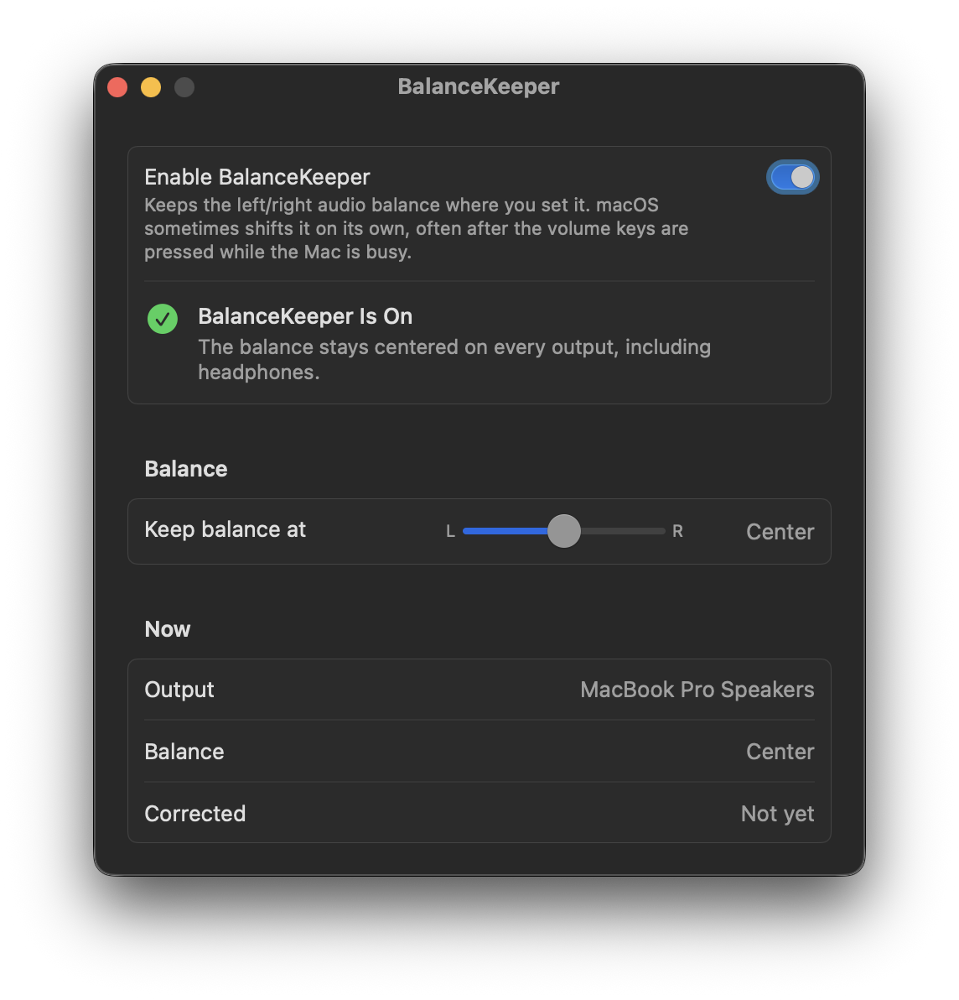

# BalanceKeeper

**Keeps your Mac's audio balance centered.**

<p align="center">
  
</p>

macOS sometimes shifts the left/right audio balance on its own, often after the volume keys are pressed while the
Mac is busy. One ear gets quieter and you may not notice for days. BalanceKeeper puts the balance back the moment
it moves.

## Footprint

I wanted this to be the lightest fix there is, since it runs all day. The background agent doesn't poll and has no
timers. It sleeps until macOS reports a balance or output change. It uses about 3 MB of memory, and over 60 seconds
idle it measured 0.0 % CPU and 0 wakeups. It needs no permissions, makes no network connections and has no menu bar
icon. The settings window only runs while it's open, and the whole app is 1.5 MB.

Measured on macOS 26.7.1 with `footprint` and `top`.

## Features

- Locks the balance to the center, or to any point you choose
- Works on every output: built-in speakers, headphones, Bluetooth and USB audio devices, and switches with them
- Shows the current output, its balance and how often BalanceKeeper had to correct it
- After an update the agent restarts with the new version; moving the app to the Trash removes its login item

## Requirements

- A Mac with Apple silicon
- macOS 13 Ventura or later

Tested on a 14-inch MacBook Pro (Apple silicon) with macOS 26.7.1 Tahoe.

## Install

### Homebrew

```sh
brew install --cask fratayaydn/tap/balancekeeper
```

### Download

Download `BalanceKeeper-<version>.dmg` from the
[latest release](https://github.com/fratayaydn/balancekeeper/releases/latest), open it and drag **BalanceKeeper**
to **Applications**. The app is signed with a Developer ID and notarized by Apple.

### First run

Open **BalanceKeeper** and turn on **Enable BalanceKeeper**. There are no permissions to grant, and you can close
the window afterwards; the agent keeps running without it.

## Settings

**Keep balance at** is the same balance as in **System Settings > Sound**: moving it here moves that slider too.
While BalanceKeeper is on, change the balance here rather than in System Settings. macOS reports a change made
there exactly like a drift, so BalanceKeeper would put it back.

Leave it in the center unless you want to compensate for your hearing or your speakers.

## How it works

- `BalanceKeeper.app/Contents/MacOS/balancekeeperd` is a small background agent, registered as a login item
  through `SMAppService`. It asks CoreAudio to report changes to the default output device and to its balance, and
  otherwise sleeps.
- When the balance moves away from the lock point, it sets it back: the stereo pan for built-in speakers and most
  devices, the system's virtual balance for Bluetooth and many USB devices, or the lowered channel's volume for
  devices that only have separate left and right volumes.
- It watches its app bundle through the kernel's event queue (no polling): when the app is replaced by an update it
  restarts with the new version, and when the app is moved to the Trash it removes its login item and quits.
- `BalanceKeeper.app/Contents/MacOS/BalanceKeeper` is the SwiftUI settings window. It runs only while open.

BalanceKeeper uses only public macOS APIs.

## Building from source

Requires the Xcode Command Line Tools (`xcode-select --install`).

```sh
git clone https://github.com/fratayaydn/balancekeeper.git
cd balancekeeper
make install
```

This builds `BalanceKeeper.app`, copies it to `/Applications` and opens it. To update, pull and run `make install`
again.

Local builds are signed with a self-signed certificate that `scripts/create-signing-identity.sh` creates on the
first build, so the login item keeps working across rebuilds; `scripts/install.sh` re-registers it after each
update. To sign with your own Apple Developer ID instead:
`make install SIGN_IDENTITY="Developer ID Application: Your Name (TEAMID)"`.

## Uninstall

Move **BalanceKeeper** from Applications to the Trash (or `brew uninstall --cask balancekeeper`). The background
agent notices, removes its login item and quits. If you built it from source, `make uninstall` in the cloned folder
also removes the settings.

## Command line

```sh
/Applications/BalanceKeeper.app/Contents/MacOS/balancekeeperd --status   # prints the output and its balance
```

## More small Mac apps

- [NightKeys](https://github.com/fratayaydn/nightkeys): keyboard backlight that only comes on when you type on the
  built-in keyboard
- [CapsNow](https://github.com/fratayaydn/capsnow): turns off the Caps Lock delay, so quick taps register
- [MicKeeper](https://github.com/fratayaydn/mickeeper): keeps AirPods and iPhones off the microphone, so AirPods don't
  drop to call quality

## License

MIT license, see [LICENSE](LICENSE).
